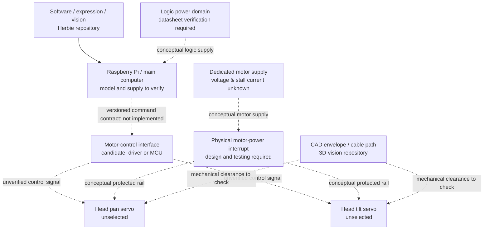

# Preliminary electronics architecture — **NOT A WIRING SCHEMATIC**

This is a functional block diagram, not build-ready pinouts, electrical ratings, or proof of safety. It is inspired by common Raspberry Pi + dedicated servo-control patterns discussed in the [Adafruit servo driver guide](https://learn.adafruit.com/adafruit-16-channel-servo-driver-with-raspberry-pi/hooking-it-up).

**Missing decisions:** specific supplies, isolation/reference grounding approach, signal voltage compatibility, actuation driver, overcurrent protection, wire and connector ratings, servo stall currents, safe startup state, physical stop design and mechanical travel.

A browser STOP command is a software feature and **must not be presented as an independent physical safety device**. Verify designs and measurements before supplying motor power; do not connect electronics from this drawing.
